<!--
  Profile README for github.com/devanshu-chauhan-nexo
  Commit this file AND the assets/ folder to the public repo devanshu-chauhan-nexo/devanshu-chauhan-nexo
-->

<a href="https://devanshuchauhan.com"></a>

  

  
  
  
  

 



I'm **Devanshu "Dev" Chauhan**, Team Lead – Full Stack at **Nexority Infotech** in Noida. I design, build, deploy and sell software, often all four in the same week. My work sits where **multi-tenant SaaS, cloud infrastructure and applied AI** meet: I lead a team of four engineers, own architecture decisions, run the AWS deployment pipeline, and write the proposals and cost sheets that win the work.

 



 


  
  <a href="https://cogniix.com"></a>

  
  

  
  

 



 



Delivered through Nexority Infotech, which is certified to <b>ISO/IEC 27001:2022</b> for software development, AI/automation and digital accessibility work.

  



  

<b>How I build: the defaults I bring to every project</b>

 

| Area | My default |
|---|---|
| **Architecture** | Next.js 14+ App Router with strict TypeScript; Spring Boot for heavy back-end domains |
| **Tenancy** | Subdomain routing, schema-level isolation and RBAC from day one, never bolted on later |
| **Infrastructure** | AWS ECS/Fargate + RDS PostgreSQL, auto-scaling, GitHub Actions CI/CD |
| **AI** | LLM features with guardrails, RAG over private data, cost-aware model choice |
| **Front-end** | Design tokens, light/dark theming, responsive and accessible (WCAG, PDF/UA) |
| **Security** | Secret rotation, encrypted PII, API hardening, least-privilege IAM |
| **Delivery** | Cost sheets, Gantt plans and deployment blueprints written alongside the code |

 



 


  <picture>
    <source media="(prefers-color-scheme: dark)" srcset="https://github-readme-stats.vercel.app/api?username=devanshu-chauhan-nexo&show_icons=true&include_all_commits=true&count_private=true&hide_border=true&border_radius=18&bg_color=04070F&title_color=73AFEF&icon_color=23D2E2&text_color=E6EDF3&rank_icon=github" />
    
  </picture>
  <picture>
    <source media="(prefers-color-scheme: dark)" srcset="https://streak-stats.demolab.com?user=devanshu-chauhan-nexo&hide_border=true&border_radius=18&background=04070F&ring=006DE2&fire=23D2E2&currStreakLabel=73AFEF&sideLabels=73AFEF&currStreakNum=E6EDF3&sideNums=E6EDF3&dates=8B949E&stroke=162644" />
    
  </picture>

  

 



 



 


  
  
  

