<!--
  Profile README for github.com/devanshu-chauhan-nexo
  Commit this file AND the assets/ folder to the public repo devanshu-chauhan-nexo/devanshu-chauhan-nexo
-->

  

  
  
  
  
  

 

I'm **Devanshu "Dev" Chauhan**, a Software Engineer and Team Lead at **Nexority Infotech** in Noida, building multi-product SaaS platforms from concept to production. I work in **Java Spring Boot, React (Next.js), TypeScript, Node.js, MySQL and MongoDB**, with deep hands-on experience in RBAC systems, billing engines, workflow orchestration, document processing and platform-level automation. I'm known for turning complex business problems into maintainable systems, mentoring teams, and holding the line on clean architecture.

 

 

  
  

  
  

  
  

 

 

  
  

 

Delivered through Nexority Infotech, which is certified to <b>ISO/IEC 27001:2022</b> for software development, AI/automation and digital accessibility work.

  

 

  

<b>How I build: the defaults I bring to every project</b>

 

| Area | My default |
|---|---|
| **Architecture** | Spring Boot services behind React / Next.js 14+ front-ends, strict TypeScript, modular boundaries |
| **Tenancy** | Tenant-isolated databases with dynamic datasource routing and tenant-aware security from day one |
| **Workflows** | RBAC, audit logs, multi-stage review and approval pipelines as first-class features |
| **Documents** | Branded PDF generation (OpenHTMLToPDF) and ingestion for PDF, DOC, EPUB, ZIP and URLs |
| **Front-end** | Design tokens, Radix UI, Redux, responsive and accessible by default |
| **Delivery** | AWS EC2/ECS, nginx, Jenkins and GitHub Actions CI/CD, with code and architecture reviews on every change |

 

 

 

  <picture>
    <source media="(prefers-color-scheme: dark)" srcset="https://github-readme-stats.vercel.app/api?username=devanshu-chauhan-nexo&show_icons=true&include_all_commits=true&count_private=true&hide_border=true&border_radius=18&bg_color=04070F&title_color=73AFEF&icon_color=23D2E2&text_color=E6EDF3&rank_icon=github" />
    
  </picture>
  <picture>
    <source media="(prefers-color-scheme: dark)" srcset="https://streak-stats.demolab.com?user=devanshu-chauhan-nexo&hide_border=true&border_radius=18&background=04070F&ring=006DE2&fire=23D2E2&currStreakLabel=73AFEF&sideLabels=73AFEF&currStreakNum=E6EDF3&sideNums=E6EDF3&dates=8B949E&stroke=162644" />
    
  </picture>

  

 

 

 

  
  
  

